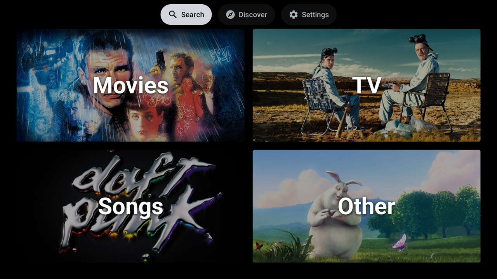
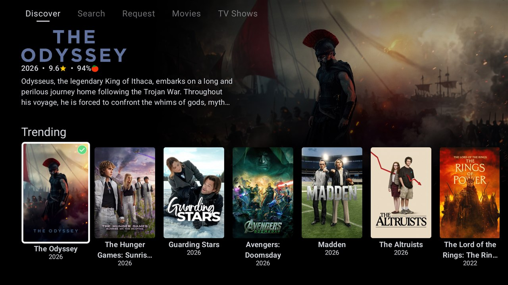

# IvanaFin for Android

<p align="center"><br><sub>Ivana thanks you for downloading</sub></p>

IvanaFin is a [Jellyfin](https://jellyfin.org) app for Android TV, Google TV and Fire TV, with its own look:
a big-tile home screen, full-screen film and show pages, a music library in the style of a TV music app,
a player laid out like Jellyfin's web player, and extras for Star Wars films and shows.
Also available: [IvanaFin for Samsung](https://github.com/CHAD2BAD/IvanaFin-Samsung) and
[IvanaFin for Jellyfin web](#jellyfin-web) (steps below).

It is a fork of [Wholphin](https://github.com/damontecres/Wholphin) by damontecres - all the hard work of
talking to Jellyfin and playing video comes from Wholphin. IvanaFin changes the design and adds features
on top.

> **Status:** early. The Star Wars extras work on any server for the official films and shows (matched by
> their TMDB id). On artist pages, Popular songs and the Albums / EPs & Singles / Mixtapes rows come from
> [Deezer](https://www.deezer.com) (the artist's name is sent to Deezer's free public API when the page opens).

## What you get

<p align="center"><br><sub>The home screen on Android TV / Fire TV</sub></p>

- **Home:** big tiles for your libraries. The first time, IvanaFin shows your biggest Movies, Shows and
  Music library, plus a library named **Other** if you have one. Choose and order them yourself in
  **Settings > Home Screen Libraries**.
- **Film and show pages** in full screen, and a player laid out like Jellyfin's web player.
- **Music** in the style of a TV music app, with Popular songs and Albums / EPs & Singles / Mixtapes on artist pages.
- **Star Wars extras** for the official films and shows: Featured Planets, Characters and Starships, the
  in-universe year, the opening crawl and "In Story Order".
- **Discover** (browse and request films and shows) - **needs Seerr set up first** (see below).
## Install

1. On the TV, allow installing apps from unknown sources (Fire TV: *Settings > My Fire TV > Developer
   options*; Google TV: *Settings > System > About*, click *Android TV OS build* 7 times, then allow your
   downloader app).
2. Download the newest APK from [Releases](../../releases) with a downloader app (for example
   *Downloader* by AFTVnews):
   - most Fire TV sticks and older Android TVs: `IvanaFin-release-armeabi-v7a.apk`
   - newer 64-bit devices (Google TV Streamer, Shield, Fire TV Stick 4K Max 2nd gen): `IvanaFin-release-arm64-v8a.apk`
   - not sure: `IvanaFin-release.apk` (works everywhere, bigger download)
3. Open IvanaFin and sign in to your Jellyfin server.

The app checks this page for new versions and tells you when one is out.

## Jellyfin web

You will manage your server from Jellyfin in a **browser**, so give it the same IvanaFin look as the app. It is added once, through the
[JavaScript Injector](https://github.com/n00bcodr/Jellyfin-JavaScript-Injector) plugin; your server then loads
IvanaFin from the [IvanaFin-Samsung](https://github.com/CHAD2BAD/IvanaFin-Samsung) repository (where the web version lives), so it stays up to date by itself. It changes Jellyfin web for **everyone** who
uses your server in a browser, and brings the ElegantFin theme with IvanaFin's colours - if you already use a
theme in *Dashboard > General > Custom CSS*, remove it. Tested with Jellyfin 12.4.

> **Important:** IvanaFin web needs the **Desktop (Legacy)** display mode. After installing, each person opens
> Jellyfin in their browser, goes to **Settings > Display**, sets **Display mode** to **Desktop (Legacy)**, saves and
> reloads the page. This is remembered per browser, so do it once on every computer / browser.

**With the installer** (Windows, macOS, Linux)

1. In Jellyfin: **Dashboard > API Keys > +**, name it "IvanaFin", and copy the key.
2. Download [web/install.ps1](https://github.com/CHAD2BAD/IvanaFin-Samsung/blob/main/web/install.ps1) (*Download raw file* button) and run it with your server's address:

   ```
   powershell -ExecutionPolicy Bypass -File install.ps1 -Server http://<your-server>:8096
   ```

   On macOS / Linux use [PowerShell](https://learn.microsoft.com/powershell/scripting/install/installing-powershell):
   `pwsh -File install.ps1 -Server http://<your-server>:8096`

   It asks for the API key. If the JavaScript Injector plugin isn't there yet, it installs it and asks
   to restart Jellyfin once (in Docker, start the container again if it stops instead of restarting).
3. Open Jellyfin in your browser, set **Settings > Display > Display mode** to **Desktop (Legacy)**, and reload the
   page (**Ctrl+F5**).

**By hand**

1. **Dashboard > Plugins > Repositories** (or *Catalog* > the settings icon): add a repository named
   `n00bcodr Plugins` with the URL
   `https://raw.githubusercontent.com/n00bcodr/jellyfin-plugins/main/manifest.json`
2. **Dashboard > Plugins > Catalog**: install **JavaScript Injector**, then restart Jellyfin.
3. **Dashboard > Plugins > JavaScript Injector**: add a script named `IvanaFin`, paste this, make sure it is
   enabled, and save:

   ```js
   // IvanaFin for Jellyfin web - https://github.com/CHAD2BAD/IvanaFin-Samsung#jellyfin-web
   (function () {
     if (window.IvfWebLoader) return; window.IvfWebLoader = true;
     var s = document.createElement('script');
     s.src = 'https://cdn.jsdelivr.net/gh/CHAD2BAD/IvanaFin-Samsung@main/web/ivanafin.js';
     s.onerror = function () { console.error('IvanaFin could not be loaded from ' + s.src); };
     (document.head || document.documentElement).appendChild(s);
   })();
   ```
4. In Jellyfin, set **Settings > Display > Display mode** to **Desktop (Legacy)**, then reload the page (**Ctrl+F5**).

Updates arrive by themselves within about 12 hours of a new version in IvanaFin-Samsung (that's how long the
[jsDelivr](https://www.jsdelivr.com) copy is kept).

**To remove it:** run the installer again with `-Uninstall` at the end, or delete the `IvanaFin` script under
**Dashboard > Plugins > JavaScript Injector**, then reload the page.

## Discover needs Seerr

<p align="center"><br><sub>Discover on Android TV / Fire TV</sub></p>

Everything else works with a plain Jellyfin server, but **Discover (browse and request films and shows)
only appears once [Seerr](https://github.com/seerr-team/seerr) is set up**. Without it, Discover is hidden.
To turn it on:

1. Set up the download side first. All of these are needed - Discover depends on them working together:
   - [Radarr](https://github.com/Radarr/Radarr) (films) and [Sonarr](https://github.com/Sonarr/Sonarr) (shows),
     with a download client (for example qBittorrent).
   - [Prowlarr](https://github.com/Prowlarr/Prowlarr), connected to Radarr and Sonarr: it gives them the
     indexers to search. Without it, requests are accepted but nothing is ever found.
   - [Cleanuparr](https://github.com/Cleanuparr/Cleanuparr), connected to Radarr and Sonarr: it removes
     stuck or stalled downloads and searches again. Without it, a request can sit at "Downloading" forever.

   Also recommended:
   - [FlareSolverr](https://github.com/FlareSolverr/FlareSolverr), added to Prowlarr: lets Prowlarr use
     indexers that sit behind Cloudflare's "checking your browser" page. Without it, those indexers fail.
   - [Recyclarr](https://github.com/recyclarr/recyclarr): keeps Radarr's and Sonarr's quality profiles in
     line with the [TRaSH Guides](https://trash-guides.info), so requests download in a sensible quality and size.
   - [Bazarr](https://github.com/morpheus65535/bazarr), connected to Radarr and Sonarr: downloads subtitles
     for what they bring in.
2. Install and set up [Seerr](https://github.com/seerr-team/seerr), connected to your Jellyfin server and to
   Radarr / Sonarr. In Seerr's settings:
   - **Users:** import your Jellyfin users (*Users > Import Jellyfin Users*). Every person who should
     request needs a Seerr user with the **Request** permission - without it Discover still opens, but
     requests are refused. Give **Auto-Approve** too if requests should download straight away instead of
     waiting for you to approve them.
   - **Services:** pick the default Radarr and Sonarr server, with a root folder and quality profile that
     really exist there (a wrong root folder makes every request fail).
3. In IvanaFin open **Settings > Seerr integration**, enter your Seerr address and sign in (your
   Jellyfin user works).
4. **Cancel button (recommended):** run the small [IvanaFin Seerr helper](https://github.com/CHAD2BAD/IvanaFin-Samsung/tree/main/seerr-helper) with Docker
   on the same machine as Jellyfin. It gives Discover a real **Cancel**: the request is removed in Seerr
   *and* the download is stopped in Radarr / Sonarr. Without it, Cancel only removes the request in Seerr and the download carries on.
5. Discover then appears in IvanaFin.

## Build it yourself

Requirements: JDK 21 and the Android SDK.

```
./gradlew assembleDefaultRelease
```

Release builds are signed with the key configured in `~/.gradle/gradle.properties`
(`IVF_RELEASE_STORE_FILE`, `IVF_RELEASE_STORE_PASSWORD`, `IVF_RELEASE_KEY_ALIAS`); without it, set
`release.signing.config=debug` in `local.properties` to sign with your debug key.

## Credits and licences

- **Wholphin** - the app this is built on, by damontecres and contributors, GPL-2.0.
- **Jellyfin** SDK and server - GPL-2.0.
- **Star Wars facts** shown in the Planets / Characters / Starships rows are summarised from
  [Wookieepedia](https://starwars.fandom.com) (text under CC BY-SA 3.0). The pictures are copies from Wookieepedia, kept in
  [extras/star-wars](extras/star-wars) so the app can show them on any server; they belong to their owners.
  Star Wars is a trademark of Lucasfilm Ltd. This project is not affiliated with Lucasfilm or Disney.
- Icons: Material Icons (Apache 2.0), Font Awesome Free (fonts SIL OFL 1.1, icons CC BY 4.0).

IvanaFin is free software under the **GNU General Public License v2** (see [LICENSE](LICENSE)), like
Wholphin. Wholphin's original README is kept as [README-Wholphin.md](README-Wholphin.md).
